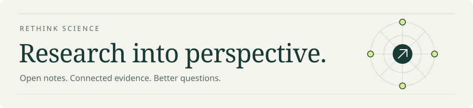

<picture>
  <source media="(prefers-color-scheme: dark)" srcset="assets/profile-dark.svg">
  
</picture>

# Rethink Science

**Research signals. Engineering questions. Evidence you can follow.**

I build open briefings and connected research notes across **materials, AI, robotics, circularity, electrification and carbon** — to help readers explore what is changing, what the evidence supports, and what to investigate next.

材料与智能，能源与循环。用可追溯的证据，把研究动态连接到工程问题。

**[Research garden ↗](https://rethinksci-gif.github.io/)** · [中文阅读入口](https://rethinksci-gif.github.io/#chinese-guide) · [Latest briefings](#latest-briefings) · [Projects & subscriptions](#projects--subscriptions)

## Start with a question

- **How does AI help materials R&D?** [从预测材料性能，到建立可靠的研发闭环](https://rethinksci-gif.github.io/material-intelligence/case-study/ai-materials-rd-closed-loop) — a literature-based learning note, in Chinese.
- **What should we test when a material substitution fails?** [ABS → PCR PP engineering diagnosis](https://rethinksci-gif.github.io/engineering-case-notes/abs-to-pcr-pp-electroplating-diagnosis) — hypotheses, evidence, and minimum experiments, in Chinese.
- **What is changing in the field?** Choose a publication below, read its evidence, or subscribe to its feed.

## Latest briefings

<!-- latest starts -->
| Briefing | Latest issue | Date |
| --- | --- | --- |
| **AIM4R** Weekly · 中文 / EN | [AIM4R Research Radar · 2026-10-12](https://rethinksci-gif.github.io/AIM4R/2026/10/12/summary-en.html) | 2026-10-12 |
| **Plastic Signal Weekly** Weekly · EN | [Plastics brief: 12 picks from 43 signals](https://rethinksci-gif.github.io/plastic-signal-weekly/2026/10/18/summary-en.html) | 2026-10-18 |
| **Electrification Intelligence** Editions · EN / 中文 | [A cleaner power mix. An unfinished substitution.](https://rethinksci-gif.github.io/electrification-intelligence-site/en/analyst-editions/001/) | 2026-10-07 |
| **CCU Intelligence** Biweekly · EN | [Offtake Momentum for e-SAF and e-Methanol, and CO2 Electrolysis Trade-offs](https://rethinksci-gif.github.io/ccu-intelligence/issues/issue-001-research-2026-10-09/) | 2026-10-09 |
<!-- latest ends -->

Refreshed daily from each briefing's public feed by <a href=".github/workflows/build.yml">a GitHub Action</a>.

## Projects & subscriptions

Project names open the publications; **Code** opens the repositories and their methods.

| Publication | Questions it follows | Code & follow |
| --- | --- | --- |
| **[AIM4R](https://rethinksci-gif.github.io/AIM4R/)** | What is advancing in robotics, embodied AI and materials? | [Code](https://github.com/rethinksci-gif/AIM4R) · [RSS 中文](https://rethinksci-gif.github.io/AIM4R/feed-zh.xml) · [RSS EN](https://rethinksci-gif.github.io/AIM4R/feed-en.xml) |
| **[Plastic Signal Weekly](https://rethinksci-gif.github.io/plastic-signal-weekly/)** | How are materials innovation, recycling and regulation changing plastics? | [Code](https://github.com/rethinksci-gif/plastic-signal-weekly) · [RSS](https://rethinksci-gif.github.io/plastic-signal-weekly/feed-en.xml) |
| **[Electrification Intelligence](https://rethinksci-gif.github.io/electrification-intelligence-site/en/)** | Where is electrification progressing, and what constrains it? | [Code](https://github.com/rethinksci-gif/electrification-intelligence-site) · [中文](https://rethinksci-gif.github.io/electrification-intelligence-site/zh/) |
| **[CCU Intelligence](https://rethinksci-gif.github.io/ccu-intelligence/)** | What shapes carbon utilization deployment, economics and climate performance? | [Code](https://github.com/rethinksci-gif/ccu-intelligence) · [RSS](https://rethinksci-gif.github.io/ccu-intelligence/rss.xml) |

### Research tools

| Tool | Use it to… | Source |
| --- | --- | --- |
| **[BioGlue Intelligence](https://rethinksci-gif.github.io/bioglue-intelligence/)** | Explore bio-based wood adhesive chemistry, routes, and evidence gaps. | [Code](https://github.com/rethinksci-gif/bioglue-intelligence) |
| **[Plastics Policy Tracker](https://rethinksci-gif.github.io/plastics-policy-tracker/)** | Find plastics regulations and trace them to official sources. | [Code](https://github.com/rethinksci-gif/plastics-policy-tracker) |

## How the work is made

- **Sources first:** every signal links back to its primary source. Missing evidence stays missing; it is never filled in to hit a quota.
- **Transparent by default:** scoring, calculations and selection rules are documented in each repository.
- **Automation drafts, people decide:** the weekly briefings are generated by documented, scheduled pipelines; CCU and Electrification editions are published only after editorial review.

## 中文导览

这里汇集材料、人工智能、机器人、循环经济、电气化与碳捕集利用方向的研究笔记、工程案例和情报工具。所有内容以证据为先，标注原始来源；周报由公开规则自动生成，CCU 与电气化专刊经人工审阅后发布。

- 从 [中文阅读入口](https://rethinksci-gif.github.io/#chinese-guide)、[知识花园](https://rethinksci-gif.github.io/) 与 [工程案例](https://rethinksci-gif.github.io/engineering-case-notes/) 开始，按主题深入阅读。
- 阅读 [AIM4R](https://rethinksci-gif.github.io/AIM4R/) 与 [电气化情报中文版](https://rethinksci-gif.github.io/electrification-intelligence-site/zh/)，追踪机器人、材料与能源转型。
- 关注 [Plastic Signal Weekly](https://rethinksci-gif.github.io/plastic-signal-weekly/) 与 [CCU Intelligence](https://rethinksci-gif.github.io/ccu-intelligence/)，了解塑料循环与碳利用方向的英文简报。
- 按问题查找 [生物胶黏剂知识库](https://rethinksci-gif.github.io/bioglue-intelligence/) 与 [塑料政策追踪器](https://rethinksci-gif.github.io/plastics-policy-tracker/)。

## Connect

Have a source to share, a correction, or a research question? [Email me](mailto:rethinksci@gmail.com), or open an issue in the relevant project above.

[Research garden source](https://github.com/rethinksci-gif/rethinksci-gif.github.io) · [All repositories](https://github.com/rethinksci-gif?tab=repositories)

---

Built in the open. Follow the sources, read the rules, explore the connections.
